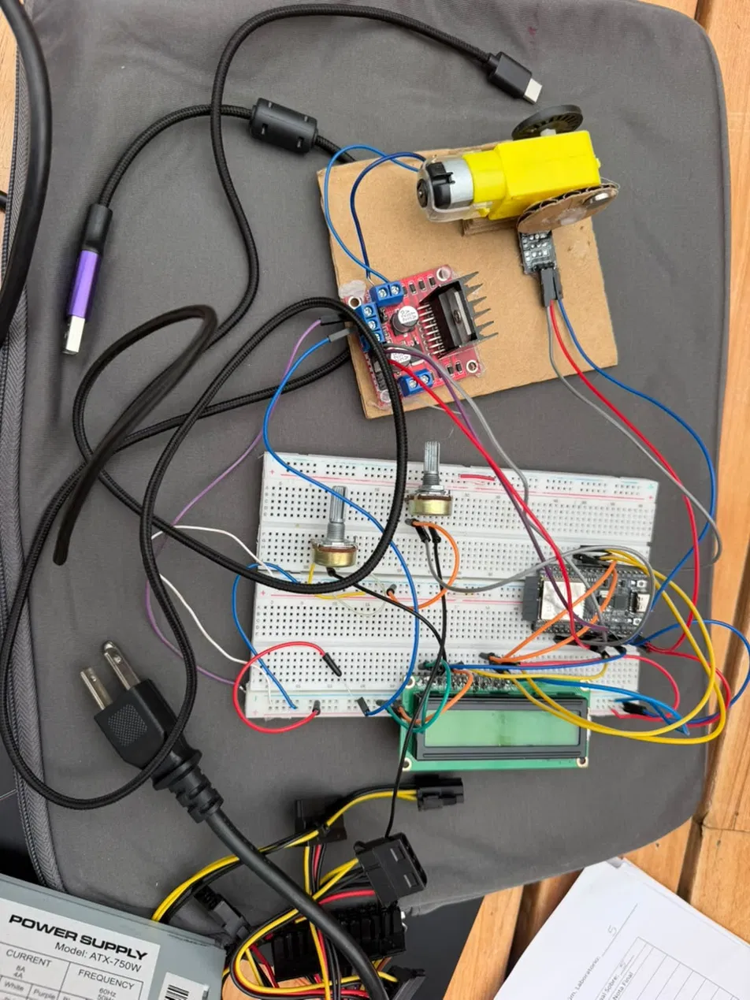
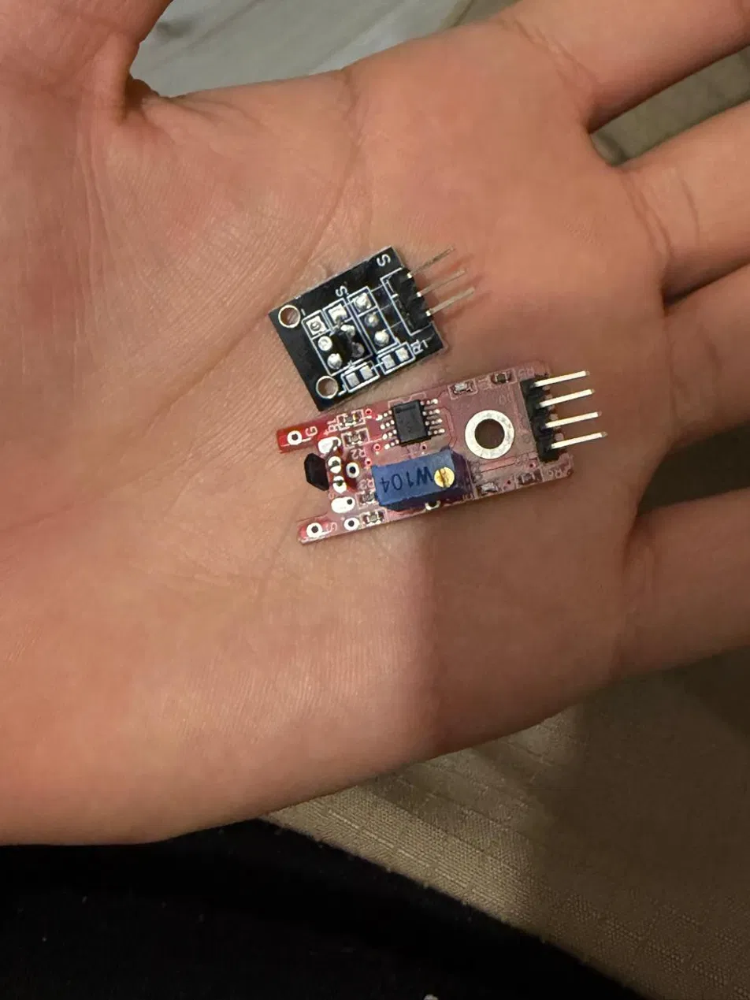
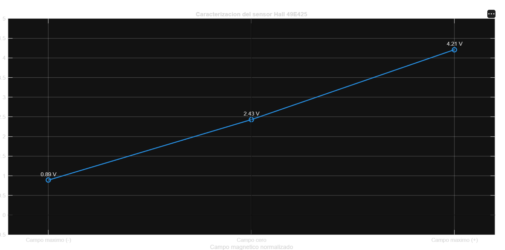
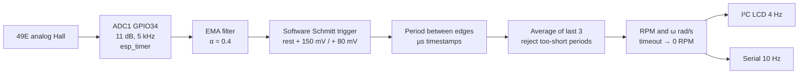

# Hall-Effect Tachometer: ESP32 & STM32

Measuring the angular speed of a DC gear motor with Hall-effect sensors. The project has three parts: characterizing a linear Hall sensor, building a tachometer that failed in the lab, and redesigning the firmware after working out why it failed.

> Lab project, Sensors & Instrumentation, B.Sc. Mechatronics Engineering, Universidad Militar Nueva Granada. Team of 3 students.

  
  

## 1. Linear Hall sensor characterization (49E)

Output voltage of the 49E linear sensor at zero field and with both magnet polarities:

| Field | Output |
|---|---|
| Max. negative | 0.89 V |
| Zero | 2.43 V |
| Max. positive | 4.21 V |

The output varies continuously with the field and tells the two poles apart. Three points are not enough to prove linearity, so this is a basic characterization.

## 2. First tachometer and why it failed

The test bench: a yellow gear motor with a magnet disc (2 magnets), a **KY-003** digital Hall module, an **L298N** H-bridge, a potentiometer to set the speed, an I²C 16×2 LCD and an ATX PC power supply.

The first firmware **counted pulses in a 500 ms window**. The motor speed followed the potentiometer, but the RPM reading jumped around. Afterwards I worked out the main cause:

$$\Delta RPM_{count} = \frac{60}{N_{magnets}\, T_{window}} = \frac{60}{2 \times 0.5\ \text{s}} = 60\ \text{RPM}$$

A resolution of 60 RPM is far too coarse when the motor tops out at about 250 RPM: one extra or missing pulse moves the reading by roughly 25 % of full scale. Other factors added to it: the signal voltage level, motor noise, and the sensor, algorithm and LCD running at different time scales.

## 3. Redesign: the period method

Measuring the **time between pulses** instead of counting them makes the resolution depend on the timer (1 µs) rather than on the window length:

$$RPM = \frac{60 \times 10^6}{\bar{T}_{\mu s}\; N_{magnets}}$$

At 250 RPM with one magnet, T ≈ 240 ms, so a 1 µs timer gives a theoretical resolution far below the 0.5 RPM shown on the display.

### `firmware/tachometer_esp32_adc` (ESP32)

- **Two input modes:** sample an analog Hall directly, or take a comparator/op-amp output on an interrupt (GPIO27).
- **Noise handling:** an exponential moving-average filter, a trigger with hysteresis, and rejection of any period shorter than the maximum valid speed allows.
- **Stopped motor:** after a timeout the reading drops to 0. While the motor is braking, the RPM is capped by the time since the last pulse, so the display doesn't freeze on an old value.
- **Shared data:** the ISR/timer and `loop()` exchange data inside critical sections (`portENTER_CRITICAL`).
- **Units:** shows both RPM and angular speed in rad/s.

### `firmware/tachometer_stm32` (STM32, Arduino core)

The same measurement ported to an STM32. The sensor drives an external interrupt on PA1, a potentiometer on PA0 sets the motor PWM on PA8, and the LCD sits on I²C (PB6/PB7, PCF8574 at 0x20) with 0.5 RPM resolution. If no pulse arrives for 2 s, the display shows 0.

## Status

| Part | Status |
|---|---|
| Hall sensor characterization | ✅ done in lab |
| Counting-window tachometer | ⚠️ ran, but the reading was unstable (analysed above) |
| Period-method firmware (ESP32 and STM32) | 🔧 redesigned; validating against a reference tachometer is the next step |

## Lessons learned

- **Pick the measuring method to fit the speed range.** Counting suits fast signals; timing the period suits slow ones.
- **Line up the time scales** of the sensor, the algorithm and the display before debugging the wiring.
- **Write down failures.** The unstable reading is the reason the redesign exists.

---

<b>🇪🇸 Versión en español</b>

## Tacómetro con sensor de efecto Hall (ESP32 y STM32)

Medición de la velocidad angular de un motorreductor con sensores de efecto Hall. Práctica de Sensores y Laboratorio, Ingeniería Mecatrónica, UMNG. Grupo de 3 estudiantes.

1. **Caracterización del sensor lineal 49E:** dio 0,89 V, 2,43 V y 4,21 V con campo negativo, nulo y positivo.
2. **Primer tacómetro:** KY-003, L298N, ESP32 y LCD. Contaba pulsos en una ventana de 500 ms con 2 imanes. La resolución resultante era de 60 RPM frente a un máximo de unos 250 RPM, y por eso la lectura era inestable.
3. **Rediseño por el método del periodo:** se mide el tiempo entre pulsos con resolución de 1 µs. El firmware del ESP32 muestrea el sensor a 5 kHz, aplica un filtro EMA y un disparador con histéresis, promedia los últimos periodos, descarta el ruido y pone la lectura en 0 cuando el motor se detiene. También está la versión para STM32.

**Estado:** falta validar el firmware nuevo contra un tacómetro de referencia.

